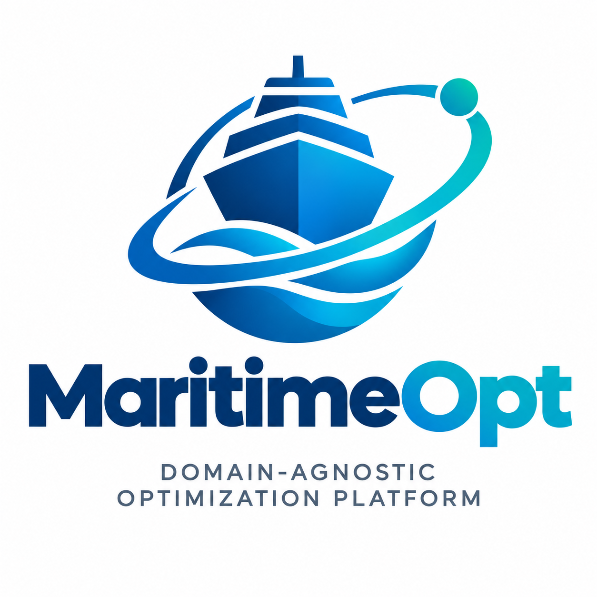
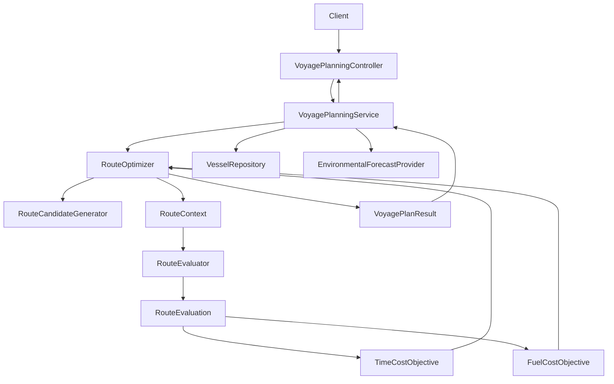

# Maritime Route Optimization

A modular, extensible reference architecture for maritime voyage planning and route optimization, built with **Java 17, Spring Boot, and Maven**.

The project demonstrates how to separate voyage-planning orchestration, route generation, route evaluation, optimization objectives, and external data access behind explicit interfaces and contracts.

<!-- Replace the path below with the repository's actual logo path. -->
<p align="center">
  
</p>

<p align="center">
  <strong>Evaluate once. Optimize for different objectives.</strong>
</p>

---

## Table of Contents

- [Overview](#overview)
- [Design Decisions and Implementation Scope](#design-decisions-and-implementation-scope)
- [Target Architecture](#target-architecture)
- [Project Structure](#project-structure)
- [Architecture and Design Principles](#architecture-and-design-principles)
- [Route Evaluation and Objective Functions](#route-evaluation-and-objective-functions)
- [Optimization Results](#optimization-results)
- [Configuration and Dependency Injection](#configuration-and-dependency-injection)
- [Running the Application](#running-the-application)
- [Example Request](#example-request)
- [Intentionally Deferred Work](#intentionally-deferred-work)
- [Technology Stack](#technology-stack)

---

## Overview

Maritime voyage planning involves selecting routes that satisfy operational constraints while balancing objectives such as fuel consumption, voyage duration, and potentially other operational or economic costs.

The system establishes a software architecture for this problem by separating the domain-independent optimization workflow from maritime-specific implementations.

The current reference implementation provides:

- A REST endpoint for voyage-planning requests.
- Application-level orchestration of the planning process.
- Interfaces for route-candidate generation and route evaluation.
- A common evaluation result containing feasibility information and estimated voyage metrics.
- Pluggable objective functions for minimizing voyage time or fuel consumption.
- Ranking of feasible candidate routes according to the selected objective.
- Dependency injection and configuration of replaceable components.
- Demonstration implementations that allow the application to run without live maritime data services.

The emphasis is on **clear contracts, separation of responsibilities, and extensibility**. The sample route generator, vessel repository, environmental forecast provider, and physical evaluation model are illustrative implementations, not operational maritime services.

## Design Decisions and Implementation Scope

### Architectural decisions

1. **Separate orchestration from domain operations.** The voyage-planning service coordinates the workflow without embedding route-generation, evaluation, or optimization algorithms.
2. **Define explicit interfaces.** Route generation, evaluation, vessel lookup, and environmental forecast acquisition are represented by contracts that can have alternative implementations.
3. **Evaluate each candidate once per optimization run.** The evaluator calculates the common metrics and feasibility information. Objective functions score the resulting evaluation instead of independently rerunning the physical model.
4. **Separate evaluation from optimization preference.** The same route evaluation can support different objectives, including time and fuel, without coupling the evaluator to a particular objective.
5. **Treat evaluation failures separately from infeasibility.** A failed evaluation means the system could not successfully evaluate a candidate; it does not establish that the route itself is infeasible.
6. **Use dependency injection for replaceable implementations.** Spring wires application services, objective functions, evaluators, and configured ports.
7. **Keep the reference implementation intentionally bounded.** Simple models and sample data demonstrate the architecture without prematurely committing to a particular production routing algorithm or external infrastructure.

### Scope of the current implementation

The reference implementation demonstrates the following flow:

1. Accept a voyage-planning request.
2. Retrieve vessel information and an environmental forecast.
3. Select a time- or fuel-based objective.
4. Generate candidate routes.
5. Evaluate each candidate once.
6. Exclude candidates that failed evaluation or were found infeasible.
7. Calculate objective costs for eligible candidates.
8. Rank the candidates by ascending cost.
9. Return a structured result with route details, evaluation metrics, and objective costs.

This is a reference architecture and a starting point for domain validation. It does not yet implement a production-grade maritime routing or fuel-consumption model.

## Target Architecture

The architecture separates the API boundary, application workflow, optimization process, evaluation model, and replaceable domain and infrastructure services.



### Request-to-result flow

1. **API:** `VoyagePlanningController` accepts a voyage-planning request.
2. **Orchestration:** `VoyagePlanningService` retrieves the required vessel and forecast data and resolves the requested objective.
3. **Candidate generation:** `RouteCandidateGenerator` produces possible routes.
4. **Evaluation:** `RouteEvaluator` evaluates each route in a `RouteContext`.
5. **Objective scoring:** The selected `RouteObjective` calculates a cost from the evaluation metrics.
6. **Ranking:** `RouteOptimizer` filters unsuccessful or infeasible evaluations and ranks the remaining routes.
7. **Response:** `VoyagePlanResult` returns the outcome, ranked routes, evaluation details, and diagnostic information where available.

The diagram shows the principal relationships. The concrete candidate generator and data providers are supplied through dependency injection, allowing demonstration implementations to be replaced independently.

## Project Structure

The proposed repository layout is:

```text
maritime-route-optimization/
├── pom.xml
├── README.md
├── assets/
│   └── logo.png
└── src/
    └── main/
        ├── java/
        │   └── com/
        │       └── varopt/
        │           └── maritime/
        │               ├── MaritimeRouteApplication.java
        │               ├── api/
        │               │   └── VoyagePlanningController.java
        │               ├── application/
        │               │   ├── VoyagePlanningService.java
        │               │   └── RouteOptimizer.java
        │               ├── domain/
        │               │   ├── VoyageRequest.java
        │               │   ├── Vessel.java
        │               │   ├── Route.java
        │               │   ├── RouteContext.java
        │               │   ├── RouteEvaluation.java
        │               │   ├── EvaluationStatus.java
        │               │   ├── ConstraintViolation.java
        │               │   └── VoyagePlanResult.java
        │               ├── objective/
        │               │   ├── RouteObjective.java
        │               │   ├── TimeCostObjective.java
        │               │   └── FuelCostObjective.java
        │               ├── port/
        │               │   ├── RouteCandidateGenerator.java
        │               │   ├── RouteEvaluator.java
        │               │   ├── VesselRepository.java
        │               │   └── EnvironmentalForecastProvider.java
        │               ├── evaluation/
        │               │   └── DefaultRouteEvaluator.java
        │               └── config/
        │                   └── OptimizationConfiguration.java
        └── resources/
            └── application.yml
```

### Package responsibilities

| Package | Responsibility |
|---|---|
| `api` | HTTP request and response boundary |
| `application` | Coordinates planning, evaluation, objective selection, and ranking |
| `domain` | Request and result models, routes, evaluation contracts, and domain data |
| `objective` | Objective-function contract and concrete cost functions |
| `port` | Interfaces for replaceable capabilities and external data access |
| `evaluation` | Default implementation of route metric calculation and feasibility checks |
| `config` | Spring bean configuration and demonstration implementations |
| `resources` | Application configuration |

`pom.xml` defines the Maven build and dependencies. `application.yml` holds application-level configuration, such as the application name and HTTP port.

## Architecture and Design Principles

### 1. Abstractions, interfaces, and contracts

The system uses interfaces to define what a component is responsible for without forcing the rest of the application to depend on how that responsibility is implemented.

#### `RouteCandidateGenerator`

```java
List<Route> generateCandidates(VoyageRequest request);
```

**Responsibility:** Generate candidate routes for a voyage request.

Implementations could eventually use graph search, navigational networks, weather-aware route generation, or specialized maritime routing algorithms. The optimizer does not need to know which algorithm produced a candidate.

#### `RouteEvaluator`

```java
RouteEvaluation evaluate(RouteContext context);
```

**Responsibility:** Evaluate a route against the available vessel, environmental, and operational context.

The contract returns a common evaluation result. It does not decide which optimization objective should be preferred.

#### `RouteObjective`

```java
String name();

double calculateCost(RouteEvaluation evaluation);
```

**Responsibility:** Convert evaluation metrics into a scalar cost that can be minimized.

Different objectives can reuse the same evaluation result. Lower cost is better for the current ranking implementation.

#### Data-access and forecast ports

```java
Optional<Vessel> findById(String vesselId);

EnvironmentalForecast getForecast(VoyageRequest request);
```

`VesselRepository` abstracts vessel lookup. `EnvironmentalForecastProvider` abstracts access to forecast data. These contracts allow test doubles, sample implementations, or real external integrations to be substituted without redesigning the planning workflow.

### 2. Domain models and evaluation contracts

The main domain types have distinct roles:

- **`VoyageRequest`** represents the requested voyage, including vessel ID, origin, destination, departure time, constraints, and objective preference.
- **`Vessel`** holds vessel parameters required by the evaluation model.
- **`Route`** represents a candidate route and its legs.
- **`RouteContext`** groups the route and the vessel, forecast, and options required to evaluate it.
- **`RouteEvaluation`** represents the evaluation status, feasibility, estimated fuel, estimated duration, constraint violations, and diagnostics.
- **`ConstraintViolation`** describes a constraint that the candidate fails to satisfy.
- **`VoyagePlanResult`** represents the overall outcome and any ranked routes, including each route's evaluation and objective cost.

The evaluation status and feasibility flag convey different information:

- `SUCCESS` with `feasible = true`: evaluation succeeded and no implemented constraint violation was found.
- `SUCCESS` with `feasible = false`: evaluation succeeded but the route violates one or more implemented constraints.
- `FAILED`: evaluation did not complete successfully; the route's feasibility has not been established.

In the current skeleton, failed evaluations use placeholder numeric values in the failure factory. Those values must not be interpreted as real estimates; a production contract should make unavailable metrics explicit.

### 3. Separation of processes

The design distinguishes four activities that should evolve independently:

1. **Data acquisition:** Retrieve vessel parameters and environmental forecasts.
2. **Candidate generation:** Produce routes that might satisfy the voyage requirements.
3. **Candidate evaluation:** Calculate metrics and check implemented constraints.
4. **Optimization:** Apply an objective and rank the successfully evaluated, feasible candidates.

This separation makes it possible to change a route-generation algorithm without rewriting the evaluator, introduce a more realistic fuel model without changing the objective contract, or add another objective without duplicating the evaluation process.

The current application orchestration uses the selected objective for ranking. Supporting simultaneous multi-objective optimization, Pareto-front analysis, or explicit trade-off policies would require additional design.

## Route Evaluation and Objective Functions

### Route evaluation

`DefaultRouteEvaluator` provides a deliberately simple illustrative model.

For each route leg, it calculates duration as:

\[
t_i = \frac{d_i}{v_i^{\mathrm{effective}}}
\]

where:

- \(d_i\) is the leg distance in nautical miles.
- \(v_i^{\mathrm{effective}}\) is the planned speed adjusted by the forecast speed factor.

Estimated fuel for a leg is calculated as:

\[
F_i = t_i \, \dot{F}_{\mathrm{nominal}} \, f_i
\]

where:

- \(t_i\) is the leg duration in hours.
- \(\dot{F}_{\mathrm{nominal}}\) is the vessel's nominal fuel-burn rate in liters per hour.
- \(f_i\) is the forecast fuel-burn factor.

Total estimated duration and fuel are the sums across all legs:

\[
T = \sum_i t_i,
\qquad
F = \sum_i F_i
\]

The illustrative evaluator also checks basic input validity and supports a `maxDurationHours` constraint.

**Important limitation:** These equations demonstrate the evaluation contract, not a validated ship-performance model. They do not fully represent speed-dependent fuel consumption, currents, waves, wind, vessel loading, engine operating limits, navigational restrictions, or time-varying conditions. The current model also does not yet use the vessel's nominal speed as an operational speed limit.

### Time objective

`TimeCostObjective` implements `RouteObjective` and uses estimated duration as the cost:

\[
J_{\mathrm{time}} = T
\]

The optimizer ranks feasible routes from shortest estimated duration to longest.

### Fuel objective

`FuelCostObjective` implements `RouteObjective` and uses estimated fuel consumption as the cost:

\[
J_{\mathrm{fuel}} = F
\]

The optimizer ranks feasible routes from lowest estimated fuel consumption to highest.

### Why evaluate once?

The evaluator produces the common metrics once per candidate. Objective functions consume that result rather than triggering separate evaluations.

This design avoids duplicate physical-model calculations and provides a consistent basis for comparing objectives. It also supports additional objective functions—for example, distance, emissions, or monetary cost—when the evaluator exposes the required metrics.

The current objective functions each produce a single scalar cost. The selected objective determines the ranking used for the response.

## Optimization Results

`RouteOptimizer` coordinates candidate generation, evaluation, eligibility filtering, objective scoring, and ranking.

Each ranked route contains:

- The candidate `Route`.
- Its `RouteEvaluation`.
- The calculated `objectiveCost`.

The overall `VoyagePlanResult` contains a status, the objective name, the ranked routes, and a diagnostic where applicable.

The current implementation distinguishes these outcomes:

| Status | Meaning |
|---|---|
| `SUCCESS` | At least one successfully evaluated, feasible route was ranked |
| `NO_CANDIDATES` | The generator returned no candidate routes |
| `NO_FEASIBLE_ROUTE` | No candidate remained eligible after evaluation and feasibility filtering |

The implementation currently represents these overall statuses as strings; a dedicated enum would make the contract more robust.

Candidates that fail evaluation or are infeasible are excluded from the ranked result. A failed evaluation is not treated as proof of infeasibility. Retaining detailed failure diagnostics for rejected candidates is a potential improvement.

### Illustrative example

Assume a route is 600 nautical miles long, with a nominal fuel-burn rate of 500 liters per hour and forecast adjustment factors of 1.0.

| Planned speed | Estimated duration | Estimated fuel |
|---:|---:|---:|
| 15 knots | 40 hours | 20,000 liters |
| 12 knots | 50 hours | 25,000 liters |

With this simple constant fuel-burn-rate model, the faster route is preferred by **both** the time and fuel objectives. This is a consequence of the demonstration assumptions, not a general property of maritime routing.

A more realistic model in which fuel consumption changes with speed and environmental conditions can produce different rankings for time and fuel objectives.

## Configuration and Dependency Injection

### `application.yml`

The Spring Boot application configuration is located at:

```text
src/main/resources/application.yml
```

The initial configuration is intentionally small:

```yaml
spring:
  application:
    name: maritime-route-optimization

server:
  port: 8080
```

It defines the application name and HTTP port. It does not yet configure external data providers, credentials, solver parameters, or forecast services.

### `OptimizationConfiguration`

`OptimizationConfiguration.java` defines demonstration beans for the replaceable ports:

- A sample `RouteCandidateGenerator` that returns two illustrative routes.
- A sample `VesselRepository` that supplies demonstration vessel parameters.
- A sample `EnvironmentalForecastProvider` that returns neutral forecast factors.

These beans allow the reference application to be wired and exercised without connecting to production systems.

Other components, including the controller, application service, optimizer, evaluator, and objective functions, are registered through Spring component annotations and constructor injection.

In a production integration, the demonstration beans would be replaced with implementations backed by real vessel data, forecast services, and route-generation logic. Environment-specific settings and secrets should be externalized rather than committed to source control.

## Running the Application

### Prerequisites

- Java 17 or a compatible JDK.
- Maven.
- The source files in the repository.

### Build and test

From the repository root:

```bash
mvn clean test
```

### Run

```bash
mvn spring-boot:run
```

The application is configured to listen on port `8080`.

The runnable behavior depends on the demonstration bean implementations being present and correctly wired. This README describes the intended source layout and design; it does not assert that a repository has been built or tested.

## Example Request

Send a request to the planning endpoint:

```http
POST /api/v1/voyages/plan
Content-Type: application/json
```

Example JSON:

```json
{
  "vesselId": "VESSEL-101",
  "origin": "Port A",
  "destination": "Port B",
  "departureTime": "2026-10-21T08:00:00Z",
  "constraints": {
    "maxDurationHours": 72
  },
  "objective": "fuel"
}
```

Use `"time"` instead of `"fuel"` to select the time objective.

The demonstration repository and route generator are illustrative: they do not yet perform real port-specific navigation or retrieve real vessel and forecast data. The endpoint demonstrates how a request travels through the architecture and how a selected objective determines the ranking.

## Intentionally Deferred Work

The reference implementation keeps the contracts and architecture small enough to review before adding more sophisticated algorithms or infrastructure.

The following are intentionally left for later work:

### Maritime domain modeling

- Real navigational networks, chart data, waypoints, and route-leg geometry.
- Land avoidance, shipping lanes, restricted zones, and navigational safety constraints.
- Time-dependent weather, wind, waves, currents, and forecast uncertainty.
- Vessel-specific operational limits and validated performance models.

### Optimization algorithms

- Production route search and candidate-generation strategies.
- Search-space pruning, graph algorithms, and heuristic or metaheuristic methods.
- Adaptive replanning in response to changing conditions.
- Multi-objective optimization, Pareto analysis, and explicit time–fuel trade-off policies.

### Evaluation and result contracts

- Typed, validated constraint models in place of generic maps.
- Explicit representation of missing metrics when evaluation fails.
- More detailed diagnostics and reporting of rejected candidates.
- Strongly typed optimization-result statuses and defined error semantics.
- Validation of objective costs and richer infeasibility explanations.

### Data and infrastructure

- Production vessel repositories and environmental forecast integrations.
- Database persistence, caching, and external service resilience.
- Authentication, authorization, observability, and operational monitoring.
- Production deployment configuration and service-level performance testing.

### Verification

- Unit tests for objective functions, evaluators, and optimizer behavior.
- Contract tests for replaceable route generators and data providers.
- Integration tests for dependency injection and the REST endpoint.
- Scenario-based validation against known maritime planning cases.
- Performance, robustness, and numerical-model validation.

These are future extensions, not claims about current capabilities. They should be introduced as requirements and evidence justify them, rather than as assumptions embedded prematurely in the core architecture.

## Technology Stack

- **Java 17** — language and runtime baseline.
- **Spring Boot** — application startup, REST API, component management, and dependency injection.
- **Spring Web** — HTTP endpoint.
- **Spring Validation** — available for request-validation integration.
- **Maven** — build and dependency management.
- **JUnit / Spring Boot Test** — test dependencies for future and current verification.

---

## Project Status

This repository is an architectural reference for maritime voyage planning and route optimization. Its central design principle is to keep candidate generation, evaluation, objective scoring, and application orchestration separate behind explicit contracts.

The intended next step is to validate the reference voyage scenario and its acceptance criteria, then evolve the domain-specific components while preserving the architecture where the evidence supports it.

## Contributing

Development practices, contribution guidelines, architectural decisions, and project governance will be documented as the project matures.

## License

The project license will be established before the first public software release.

## Maintainer

MaritimeOpt is developed and maintained by Chris Romero.